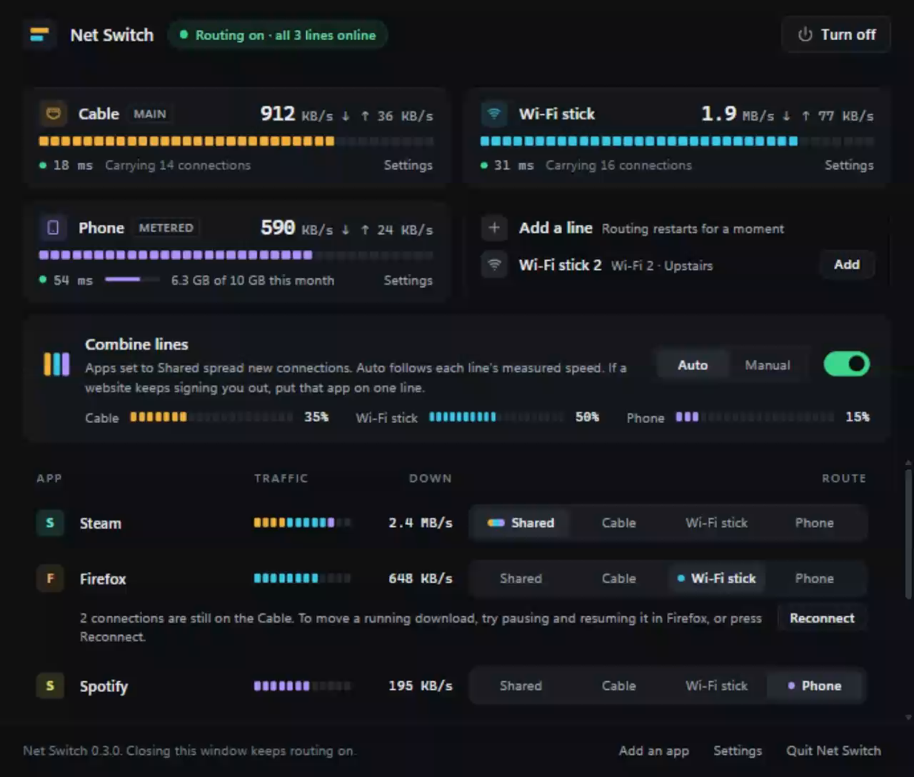
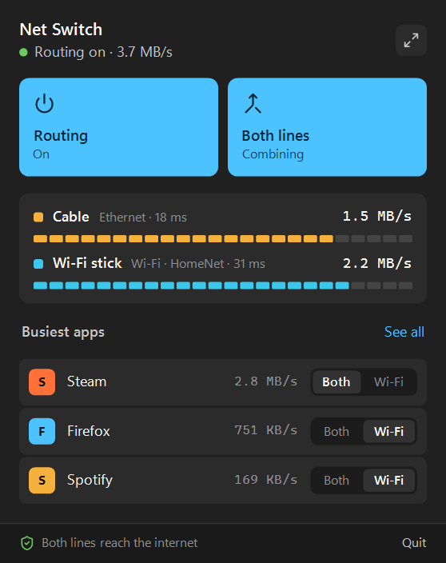

# Net Switch

Choose which internet connection each Windows app uses.



I have two internet connections at home: a cable that is slow but steady, and a
USB Wi-Fi stick on a second router. Windows kept sending everything through the
cable. When something big was downloading, everything else crawled while the
second line sat there doing nothing.

Net Switch lists the apps using your internet, sorted by speed, and lets you
send each one to the cable or to the second connection. The second connection
can be a USB Wi-Fi adapter or a phone with USB tethering.

## What it does

- **Pick a line per app.** Put the game download on one line and keep your
  browser and calls on the other.
- **Combine both lines.** New connections from the apps you haven't moved are
  spread across both lines. Downloads that open several connections at once
  (Steam, browsers, speed tests, download managers) can use both lines. Apps
  that should stay on one line, like calls or a picky website, can be kept on
  the cable.
- **Fail over.** If a line drops, or stays connected but stops reaching the
  internet, its apps move to the other line while that one works, and come back
  when it returns.
- **Live traffic meters.** Line speeds come from Windows, per-app speeds from
  the routing engine, so you can see a switch worked instead of guessing.
- **Tray controls.** The tray icon shows both lines at a glance, and a click
  opens a small panel for the common switches.



## Download

Windows 10 or 11, 64-bit. Get `NetSwitch-Setup-<version>-x64.exe` from the
[latest release](https://github.com/AyoubAchour/net-switch/releases/latest) and
run it. It includes everything Net Switch needs.

The installer isn't code-signed yet, so Windows SmartScreen may warn you about
it. Choose **More info**, then **Run anyway**. If you'd like to check the file
first, each release lists its SHA-256 hashes in `SHA256SUMS.txt`, and you can
verify it was built from this repository by GitHub Actions:

```
gh attestation verify NetSwitch-Setup-<version>-x64.exe -R AyoubAchour/net-switch
```

## Before you install

- **It asks for administrator permission each time it starts.** It needs that
  to route traffic through its own virtual network adapter and to see which app
  owns each connection. The window and tray icon run as you.
- **One connection still uses one line.** Combining spreads *connections* across
  your lines; it doesn't split a single connection. A big file downloaded over
  one connection gets one line's speed. That would need a bonding server on the
  internet (like Speedify or OpenMPTCProuter), which Net Switch doesn't use.
- **While combining, websites can see two different addresses.** Most don't
  care. If one keeps signing you out, set that browser to **Cable** so it stays
  on one line.
- **Routing is IPv4 only** while it's on.
- **Watch your data plan on a phone.** If the cable drops, everything moves to
  the second connection. And while routing is on with two lines, Net Switch
  tests each line's internet every 30 seconds (more often after a failed test),
  which comes to roughly 17 MB a day per healthy line.
- **It's young.** It's been used daily on Windows 11 with an Ethernet cable and
  a USB Wi-Fi adapter. Other setups (Windows 10, VPN software, phone
  tethering, non-English Windows) should work but haven't been tested much.
  [Bug reports](https://github.com/AyoubAchour/net-switch/issues) are welcome.

## First run

1. Open **Net Switch** from the Start menu and accept the administrator prompt.
2. When your second connection shows up, press **Use as second connection**.
3. In the app list, press the second connection's button on an app (it's named
   after the connection, like **Wi-Fi stick** or **Phone**) to move it there.
   New connections move at once. A download that's already running keeps its
   line until you pause and resume it.
4. Turn on **Combine both lines** if you want the apps you haven't moved to use
   both lines. Each app then offers **Both lines**, **Cable** and the second
   connection, so you can keep some apps on the cable.

Closing the window keeps routing on, and the tray icon brings it back. **Quit
Net Switch** turns routing off, and every app goes back to Windows' normal
connection.

Net Switch may offer two Windows changes, each with its own button: keeping the
cable as the default when Net Switch is off, and keeping Wi-Fi connected while
the cable is plugged in. It saves how things were before changing them, and
**Undo** puts them back.

The [user guide](docs/user-guide.md) explains failover, combining and the tray
in more detail.

## Uninstalling

Use **Settings → Apps → Installed apps → Net Switch → Uninstall**. It asks
whether to undo the Windows settings Net Switch changed (yes is the default).
Your Net Switch settings stay in `%LOCALAPPDATA%\Net Switch`; delete that folder
if you don't plan to reinstall.

## How it works

Net Switch runs [sing-box](https://github.com/SagerNet/sing-box) as a local
routing engine behind a virtual network adapter. sing-box sees which program
opened each new connection, and Net Switch tells it which line to send that
program's connections through. A small Node.js server keeps the rules up to
date, watches both lines, and serves the window as a page on `127.0.0.1`.

Your traffic goes straight out through your own connections; nothing is relayed
through a server of mine, and there's no telemetry. [SECURITY.md](SECURITY.md)
lists what runs as administrator, what Net Switch changes in Windows, and the
only network requests it makes on its own.

## Building from source

See [CONTRIBUTING.md](CONTRIBUTING.md). There are no npm dependencies, and
`node dev/demo-server.mjs` shows the window with sample data, without
administrator rights or a second connection.

## License

Net Switch's code is under the [MIT license](LICENSE). The installer also
includes sing-box (GPL-3.0), Node.js (MIT) and other components under their own
licenses; see [THIRD_PARTY_NOTICES.md](THIRD_PARTY_NOTICES.md). Net Switch isn't
affiliated with the sing-box project.
